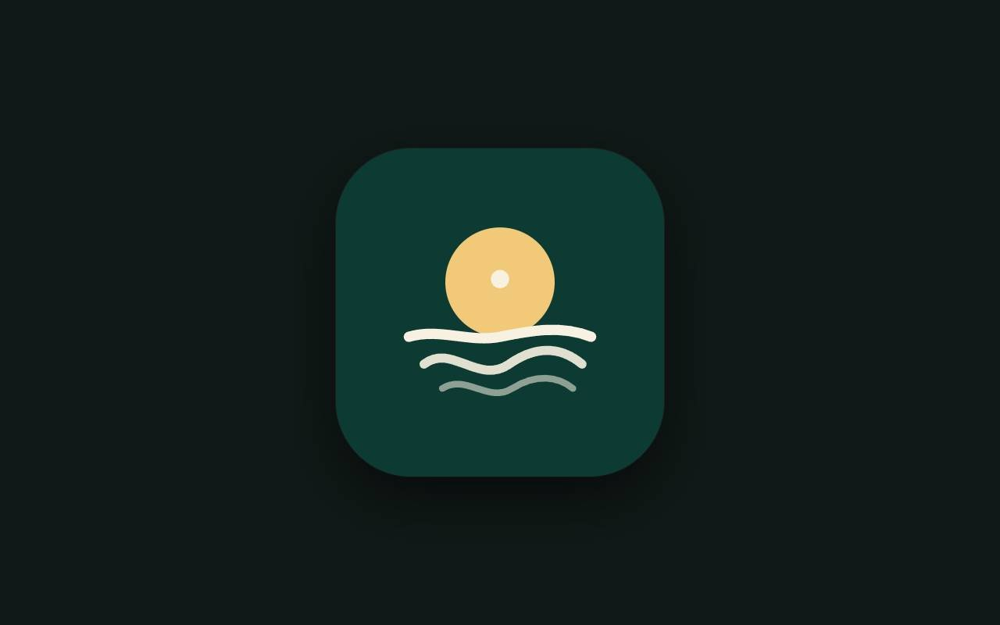
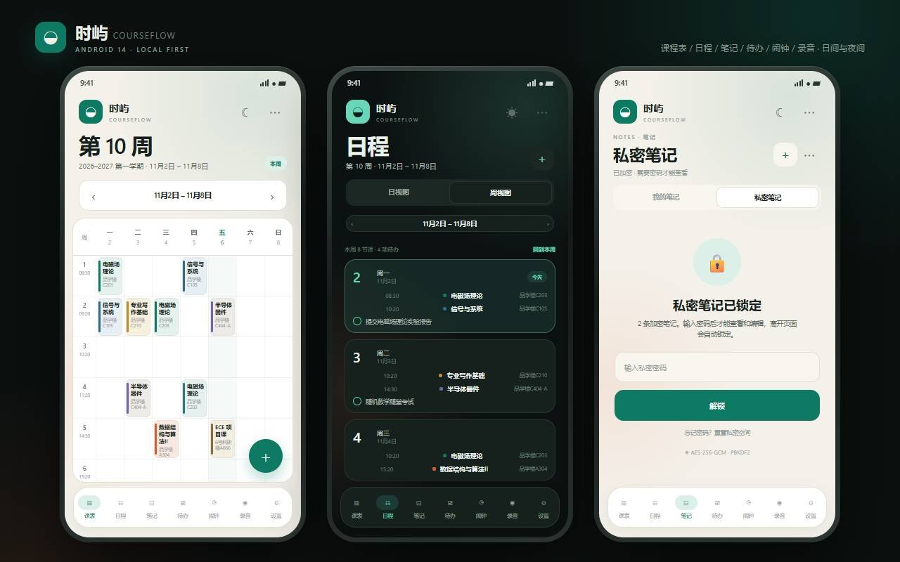

# 时屿 · CourseFlow

<p align="center">
  <strong>一个真正属于你的 Android 学习与生活工作台。</strong><br>
  <em>A private, local-first Android workspace for classes, notes, tasks and time.</em>
</p>

<p align="center">
  <a href="#亮点-highlights">亮点 Highlights</a> ·
  <a href="#技术栈-tech-stack">技术栈 Tech stack</a> ·
  <a href="#english">English</a>
</p>

> **中文**：CourseFlow（应用名「时屿」）把课表、日程、笔记、待办、录音和闹钟收进一个无账号、无服务器、无网络权限的本地优先应用。  
> **English**: CourseFlow (“时屿”) is a private, local-first Android planner combining timetable, calendar, notes, tasks, recordings and alarms — with no account, backend or network permission.

## 亮点 Highlights

- **本地优先 / Local-first**：数据留在设备上，支持 JSON 导入导出。
- **完整学习流 / Complete study flow**：周课表、日程、待办、笔记、录音、提醒一站式完成。
- **为真实使用打磨 / Built for daily use**：跨节次课程、单双周、农历节日、离线体验与 Android 14 edge-to-edge。
- **可复现构建 / Reproducible build**：提供 PowerShell 构建脚本与测试样例。

## 技术栈 Tech stack

`Java` · `Android SDK 34` · `minSdk 29` · `SharedPreferences` · `JSON` · `原生 Android UI / Native Android UI`

<a id="english"></a>

## English

CourseFlow is a polished, privacy-friendly Android companion for students and anyone who wants a calm personal organizer. It handles recurring classes, weekly planning, rich notes, task reminders, audio records and alarms without an account or cloud service.

**Why it stands out**

- Offline-first and privacy-conscious by design.
- Timetable engine with multi-week ranges, odd/even weeks and overlapping sessions.
- Calendar, notes, tasks, audio and alarms designed as one coherent workflow.
- Native Android UI with Android 14 support and a reproducible build script.

See the Chinese sections below for the full feature list, data format and build notes.

一款面向 **Android 14** 的本地优先课程表应用。周课表、日/周日程、笔记、待办、闹钟与私密空间被放进同一个安静的容器里。没有账号、没有服务器，也不申请网络权限。





> 上图是项目的视觉设计稿（HTML 预览），用于说明界面语言与布局；实际 APK 使用原生 Android 控件绘制。

---

## 直接安装

两个 APK 都已经编译、对齐并使用 APK Signature Scheme v3 签名：

```
dist/CourseFlow-1.2.2-personal.apk   个人版，应用名「时屿」
dist/CourseFlow-1.2.2-store.apk      商店示例版，应用名「时屿课程表」
```

- 包名：`com.etherealnymph.courseflow`
- 版本：`1.2.2`（versionCode 5）
- minSdk：29（Android 10）
- targetSdk / compileSdk：34（Android 14）
- 签名：APK Signature Scheme v3（Android 10+ 直接校验）
- SHA-256：见 `dist/SHA256SUMS.txt`

两个 APK 使用同一个包名，所以不能同时安装，但**数据文件分开**：

- 个人版使用 `courseflow.json`，保留你已有的课表、待办、笔记；
- 示例版使用 `courseflow_demo.json`，只载入示例课表/待办/笔记，不会覆盖个人数据。

安装示例版后再装回个人版，个人数据仍然在。首次安装需要按系统提示允许「安装未知应用」。

---

## 1.2.2 重点改动

- 课表左侧同时显示上课与下课时间；每行高度压缩到 50dp，课程卡与左侧节次严格对应；课程名 2 行，地点/教师各 1 行。
- 课程名最多显示 3 行；地点、教师各自独立换行，字号提高。
- 闹钟页面显示下一个闹钟的实时剩余时间（天/小时/分/秒）。
- 闹钟到点会通过全屏 Intent 唤亮锁屏界面，提供大号「关闭闹钟」按钮。
- 使用 `setAlarmClock` + 精确闹钟权限 + 唤醒锁，减少息屏时的响铃延迟。
- 笔记/待办里的图片在编辑器中点击可全屏放大查看。
- B/I/U/S/H1/H2/H3/注释/高亮按钮会亮起；取消后立即熄灭；不取消时后续输入持续保持该格式，历史文字不会回退。
- 笔记工具栏在没有选中文字时点 B/I/高亮/颜色，会作用于接下来输入的文字。
- 编辑器内直接显示照片内容，不再只显示文件名。
- 设置新增「录音保存目录」：Music/时屿、Music、Download/时屿、Music/Recordings/时屿。
- 删除录音页的说明行。
- 闹钟支持重复次数（1–10 次）、重复间隔（1–60 分钟）和每次响铃时长（5–120 秒）。
- 闹钟使用 MediaPlayer/系统闹钟铃声循环播放，持续到设定时长；默认只响铃不震动，可单独开启震动；点「知道了」或关闭闹钟会同时停止声音和震动。
- 待办新增提前提醒，默认提前 2 小时，可调 0–360 分钟，并可选择是否用闹铃提示。
- 页面顶部去掉大号中文标题，只保留「英文 · 页面名」，课表页去掉「时屿」品牌行。
- 提供个人版和商店示例版两个 APK；商店版应用名「时屿课程表」。
- 课程名固定最多 3 行。

- 课表卡片把课程名、地点、教师拆成独立的可换行区域，放大并提高对比度，不再重叠。
- 日历显示二十四节气与内置节日（元旦、春节、清明、劳动、端午、中秋、国庆）。
- 笔记/待办编辑器改为所见即所得：选中文字后直接加粗、高亮、改色，正文里不再出现 `**`、`==`、`~~`、`>`。
- 拍照、相册、录音、文件按钮固定在编辑框上方，不再藏在横向滚动工具栏里。
- 闹钟页新增默认闹钟：工作日 08:00 / 14:00，非工作日 09:00 / 14:30。
- 滚轮选择时间时数字连续滑动，并在 3→4 时整体跟手滑动；删除「上下滑动数字滚轮」提示。
- 录音从设置页移到独立的「录音」底部入口，文件保存到手机 `Music/时屿`。
- 节假日卡片增加间距，改为独立圆角卡片，避免边框粘连。
- 应用更名为 **时屿**，图标改为抽象日出/岛屿，不再使用「课」字。

- **11 节作息**：08:30–09:15、09:20–10:05、10:20–11:05、11:20–11:55、14:30–15:15、15:20–16:05、16:20–17:05、17:10–17:55、19:30–20:15、20:20–21:05、21:10–21:55。
- 周课表支持**点周几 / 点节次高亮**；点击顶部「第 10 周 · 11.2–11.8」卡片可快速切换到任意周。
- 课表卡片同时显示**课程名、地点、教师**；课程按节次自动跨行。
- 课程支持**课程代码**、**多段周次**（`1-10, 12-17`）、**单/双周**、**跨节次**，以及**同一课程不同时段不同地点/教师**。
- 兼容用户提供的 `timetable` / `extra_courses` 原始中文 JSON 与 `todo_list` 清单 JSON。
- 「日程」新增**农历日历**、**初几**与**节假日/调休**显示；节假日可手动添加或 JSON 导入。
- 时间选择改为**上下滑动的双滚轮**。
- 待办支持**开始提醒 + 截止时间**两条独立提醒；正文会尝试自动识别时间。
- 新增**闹钟**页：工作日、非工作日、自定义星期 + 额外日期 + 生效范围。
- 笔记/私密笔记/待办支持**简易格式标记、表格、预览、拍照、相册、录音、文件快捷方式**。
- 设置页新增**陪伴时长**；移除旧副标题；应用更名为**时屿**，图标改为日出/岛屿意象。
- 修复右上角「⋯」因 `Dialog` Context 强转导致的崩溃。

---

## 功能

### 课程表

- **周课程视图**：7 列 × 11 节，自动高亮今天；点星期标题高亮整列，点左侧节次高亮整行。
- **跨节次课程**：一门课可占第 1–2、3–4 或第 1–8 节，周课表用一整块显示。
- **课程卡片**：显示课程名、地点、教师；同一天同一格有冲突时自动分栏。
- **课程代码**：导入、编辑、详情、JSON 导出都会保留。
- **多周段 / 单双周**：如 `1-10, 12-17`、`单周 1-3, 7-13`、`双周 4-10`。
- **同课程多安排**：同一门课可有多条上课安排，每条可以单独覆盖地点、教师、节次跨度与周次。
- **快速切换周**：点击周次日期卡片，弹出第 1–N 周列表，按「第几周 + 几月几日–几日」选择。
- **日课程任务视图**：按日期查看当天课程时间线、当天待办与逾期未完成待办。
- **周视图**：逐日列出本周课程与待办，显示本周课程数/待办数；日期显示为「6日」。
- **第一周设置**：`termStartDate` 可以是任意日期，按所在周周一计算。
- **时间段编辑**：每个时间段可包含多个分段；课程安排引用时间段。
- **JSON 导入/导出**：完整保留节次跨度、周次区间、课程代码和地点/教师覆盖。

#### 内置 2026–2027 第一学期

第一周：`2026-08-31`，当前第 10 周对应 2026-11-02 至 11-08。内置课程从用户给出的课表整理，包含：

电磁场理论、信号与系统、随机数学（含概率论、数理统计、随机过程）、半导体器件与物理（高阶课程）、电子工程设计之微处理器最小系统设计、专业写作基础、大学物理II、经济学概论、数据结构与算法II、羽毛球C、改革开放史专题讲座、现代工程设计制图、大学物理实验 I、ECE 进阶式挑战性项目课、形势与政策、数学竞赛精讲。

也可以在「课表 ⋯ → 载入 2026–2027 第一学期」或「设置 → 课程表」重新载入。

### 日程与日历

- 日视图周条：周一到周日七格，选中日整格居中显示星期与日期。
- 日视图的「11月2日–8日」区域可点击打开**月历**：
  - 显示公历、**农历初几**；
  - 显示自定义节假日与「班」（调休上班）；
  - 点击日期直接切换当天日程；
  - 底部可进入「节假日设置」。
- 节假日可逐条添加、删除，或导入 JSON。`type=holiday` 为休息日，`type=workday` 为调休上班日。
- 待办完成后在日程/周视图中自动沉到底部。

### 笔记 / 私密笔记

- 普通笔记：标题、正文、置顶、6 种颜色。
- 私密笔记：未解锁前不显示标题和正文。
  - PBKDF2-HMAC-SHA256（90,000 次）派生 256 位密钥；
  - 标题、正文和附件元数据使用 **AES-256-GCM** 加密；
  - 离开笔记页、切后台、锁屏后自动锁定并关闭私密编辑器；
  - 支持修改密码（重新加密全部私密笔记）与忘记密码后重置。
- **搜索**：普通笔记、私密笔记均可按标题/正文搜索。

### 简易富文本

编辑器默认是所见即所得：选中文字后点工具栏即可，正文里不会出现 `**`、`==`、`~~`、`>` 这些符号。下表是底层存储/导入导出语法，只有在查看 JSON 或高级编辑时才需要接触。

| 写法 | 效果 |
| --- | --- |
| `# 标题` / `## 副标题` / `### 小标题` | 分级标题 |
| `> 注释` | 引用/注释块 |
| `**粗体**` | B |
| `*斜体*` | I |
| `__下划线__` | 下划线 |
| `~~删除线~~` | 中划线 |
| `==荧光==` | 高亮 |
| `[color=red]文字[/color]` | 字体颜色（red/orange/blue/green/purple/gray/#RRGGBB） |
| `[size=18]文字[/size]` | 字号 |
| `{: center}文字` / `{: right}文字` | 居中 / 居右 |
| `- [ ]` / `- [x]` | 待办勾选框 |
| Markdown 管道表 | 原生表格 |
| `` | 图片 |
| `[录音：名称](attachment:id)` | 录音，点击播放 |
| `[文件：名称](attachment:id)` | 文件快捷方式，交给手机上的应用打开 |

- **拍照 / 相册**：拍摄或选择图片，复制到应用私有目录，插入笔记。
- **录音**：独立的「录音」页；录完保存到手机 `Music/时屿`，也可以插入笔记。
- **文件快捷方式**：通过系统文件选择器取得持久 URI，点击后用外部应用打开。
- **表格**：工具栏「表格」插入模板，预览中渲染成表格。
- **预览**：编辑器内一键展开富文本预览。
- 私密笔记和待办使用同一套编辑器和标记语法。

### 待办

- 标题、备注、优先级、完成勾选。
- **开始提醒**与**截止时间**可以分别设置，互不影响；到点各自发通知。
- **正文时间识别**：离开标题/备注输入框或保存时，尝试识别 `2026/11/9 16:15`、`11月14日 下午2点`、`明天 12:30`、`11.10` 等写法，自动填入截止时间。
- **搜索**：标题/备注实时过滤。
- **完成后沉底**：待办列表、日视图、周视图都按未完成在前、已完成在后排列。
- **JSON 清单导入**：支持 `todo_list` 格式；「载入本学期待办清单」使用内置示例。
- **通知**：到点发送本地通知，通知内可直接「标记完成」。
- Android 12+ 未授权精确闹钟时自动退化为非精确提醒。

### 闹钟

- 独立「闹钟」页；可创建多个闹钟。
- 重复方式：
  - **工作日**：周一至周五，排除节假日，包含调休上班日；
  - **非工作日**：周末与节假日，排除调休上班日；
  - **工作日 + 自定义日期**：按工作日规则，再加指定日期（例如某个周末补课日）；
  - **自定义**：选择星期，并可添加额外日期。
- 支持生效开始/结束日期，留空为长期。
- 到点发送高优先级「闹钟」通知，使用系统闹钟铃声与震动。
- 闹钟设置页可直接打开节假日管理。

### 设置

- 跟随系统 / 日间 / 夜间三种模式。
- 学期与第一周、时间段管理、课程表 JSON、载入本学期课表。
- 笔记/待办导出、导入、私密笔记、待办清单导入。
- 闹钟、节假日与调休。
- 通知权限、精确提醒、测试通知。
- 底部显示「时屿已陪伴你 X 年 X 个月 X 天 X 时 X 分 X 秒」，每秒更新。

---

## JSON 格式

### 课程表（schema v2）

完整示例见 [`samples/timetable-example.json`](samples/timetable-example.json)。

```json
{
  "schema": "courseflow.timetable",
  "version": 2,
  "name": "2026–2027 第一学期",
  "termStartDate": "2026-08-31",
  "timeSlots": [
    { "id": "p1", "name": "第 1 节", "segments": [{ "start": "08:30", "end": "09:15" }] }
  ],
  "courses": [
    {
      "id": "c1",
      "name": "电磁场理论",
      "code": "G2700940.03",
      "location": "品学楼C203",
      "teachers": ["陈益凯"],
      "color": "#0F7A64",
      "sessions": [
        {
          "dayOfWeek": 1,
          "slotId": "p1",
          "endSlotId": "p2",
          "weeks": "1-10, 12-17",
          "weekRanges": [
            { "start": 1, "end": 10, "parity": "all" },
            { "start": 12, "end": 17, "parity": "all" }
          ],
          "location": "品学楼C203",
          "teachers": ["陈益凯"]
        }
      ]
    }
  ]
}
```

| 字段 | 说明 |
| --- | --- |
| `termStartDate` | 第一周开始日，`yyyy-MM-dd`，按周一归一 |
| `timeSlots[].segments` | 一个时间段可包含多个分段 |
| `courses[].code` | 课程代码 |
| `courses[].sessions[].slotId` | 开始节次 |
| `endSlotId` | 结束节次；省略表示单节 |
| `weeks` | 周次字符串，支持多区间与单双周 |
| `weekRanges` | 结构化周次，优先于 `weeks` |
| `location` / `teachers` | 可选的单个安排覆盖；省略则用课程级默认 |
| `weekParity` | 兼容旧字段：`all` / `odd` / `even` |

同时兼容原始中文格式（可直接导入）：

```json
{
  "timetable": {
    "星期一": [
      {
        "节次": "第一节",
        "课程": "电磁场理论",
        "教师": "陈益凯",
        "课程代码": "G2700940.03",
        "周次": "1-10, 12-17",
        "地点": "品学楼C203"
      }
    ]
  },
  "extra_courses": [
    {
      "课程": "数学竞赛精讲",
      "教师": "高中喜",
      "周次": "2-3, 7-10",
      "星期": "星期六",
      "节次": "第1-8节",
      "地点": "品学楼A209"
    }
  ]
}
```

导入时会自动合并连续节次、跳过「停课」行，并把同一课程的不同教师/地点/周次拆成独立安排。

### 笔记与待办

完整示例见 [`samples/notes-example.json`](samples/notes-example.json)。

- `notes[].attachments` / `todos[].attachments` 保存附件元数据。
- 私密空间导出结构：

```json
{
  "private": {
    "salt": "base64…",
    "verifierIv": "base64…",
    "verifierCipher": "base64…",
    "notes": [
      { "id": "secret_…", "iv": "base64…", "cipher": "base64…", "updatedAt": 1793960000000 }
    ],
    "cipher": "AES-256-GCM",
    "kdf": "PBKDF2-HMAC-SHA256"
  }
}
```

密码永远不会写入文件。私密附件文件保存在应用私有目录，附件路径/名称等元数据在密文中。

### 待办清单

完整示例见 [`samples/todo-list-example.json`](samples/todo-list-example.json)，支持：

```json
{
  "todo_list": [
    { "title": "练习册 P30-31", "deadline": "2026/11/9 00:00 (周日24:00)" },
    { "title": "期中考试", "content": "11月14日（周六）下午2点-4点", "timestamp": "2026/11/14 14:00" },
    { "title": "大学物理考试", "content": "明天 12:30" }
  ]
}
```

也支持 `category` + `items` 的知识清单形式，会作为一项无日期待办导入，正文保留换行。

### 节假日

完整示例见 [`samples/holidays-example.json`](samples/holidays-example.json)。

```json
{
  "holidays": [
    { "date": "2026-10-01", "name": "国庆节", "type": "holiday" },
    { "date": "2026-10-10", "name": "调休上班", "type": "workday" }
  ]
}
```

未列出的日期：周一至周五为工作日，周六周日为休息日。`workday` 会覆盖周末，`holiday` 会覆盖工作日。

---

## 构建

只需要 JDK 17、Android SDK Build-Tools 34.0.0、Platform android-34。默认使用同级目录的 `_tools/jdk` 和 `_tools/sdk`：

```powershell
pwsh -File .\build-apk.ps1 -AppLabel '时屿' -OutputSuffix '-personal'
pwsh -File .\build-apk.ps1 -Demo -AppLabel '时屿课程表' -OutputSuffix '-store'
```

输出：

```
dist/CourseFlow-1.2.2-personal.apk
dist/CourseFlow-1.2.2-store.apk
```

项目同时包含 Gradle 文件，可直接用 Android Studio 打开；无第三方运行时依赖。

---

## 数据层测试

`_test/` 中有一套不依赖 Android 运行时的 JVM 测试（真实 `org.json` + 最小 Android 桩），覆盖 48 项：

- 11 节作息、示例课程表、笔记、待办种子数据；
- 课程表 JSON 往返、跨节次、多周段、单双周、课程代码、地点/教师覆盖；
- 原始 `timetable` / `extra_courses` 中文 JSON 导入与连续节次合并；
- `todo_list` 导入、时间识别、相对日期；
- 笔记/待办 JSON 往返；
- 私密空间创建、解锁、改密、附件加密元数据、密文导出；
- 非法课程 JSON 拒绝。

```powershell
pwsh -File .\_test\run-tests.ps1
```

测试脚本不是 APK 的一部分。

---

## 项目结构

```text
CourseFlow/
├─ app/src/main/
│  ├─ assets/todo-list-example.json   内置待办清单
│  ├─ java/com/etherealnymph/courseflow/
│  │  ├─ MainActivity.java            应用壳、7 个底部入口、文件与附件选择
│  │  ├─ ScheduleScreen.java          周课表 + 快速周切换
│  │  ├─ TimetableWeekView.java       7×11 Canvas 课表、选择高亮
│  │  ├─ AgendaScreen.java            日视图 / 周视图
│  │  ├─ CalendarSheet.java           农历月历、节假日
│  │  ├─ LunarCalendar.java           ICU 农历
│  │  ├─ NotesScreen.java             普通/私密笔记
│  │  ├─ TodosScreen.java             待办、起止提醒、自动时间
│  │  ├─ AlarmScreen.java             闹钟
│  │  ├─ ClockAlarmScheduler.java     闹钟调度
│  │  ├─ ClockAlarmReceiver.java      闹钟响铃/关闭
│  │  ├─ RichEditorHelper.java        富文本工具栏、附件条、预览
│  │  ├─ RichText.java                标记渲染（标题/表格/图片/音频）
│  │  ├─ AttachmentStore.java         图片复制、文件 URI、解码
│  │  ├─ RecorderSheet.java           录音
│  │  ├─ Store.java                   JSON 持久化、schema v2
│  │  ├─ WeekSpec.java                多周段 / 单双周
│  │  ├─ LegacyImport.java            中文原始课表/清单导入
│  │  ├─ TimeTextParser.java          正文时间识别
│  │  ├─ PrivateVault.java            PBKDF2 + AES-256-GCM
│  │  └─ …
│  └─ res/                            主题、图标、矢量图标
├─ samples/                           可导入 JSON 示例
├─ preview/                           设计稿
├─ _test/                             数据层测试
├─ build-apk.ps1
└─ dist/
```

---

## 已知边界

- 仅支持竖屏。
- 附件文件不打包进笔记 JSON：导出的是附件元数据，跨设备导入后图片/录音路径可能失效；文件快捷方式依赖原 URI 授权。
- 提醒依赖通知权限；Android 12+ 若未授予「闹钟和提醒」，会使用非精确提醒。
- 私密笔记密码无法找回；忘记密码只能重置私密空间。
- 内置节假日示例不是官方放假安排，请按学校/官方通知导入或手动维护。
- 设计稿是 HTML 静态预览，不是实机截图；实际 UI 使用原生控件，字体和间距会随设备密度缩放。
